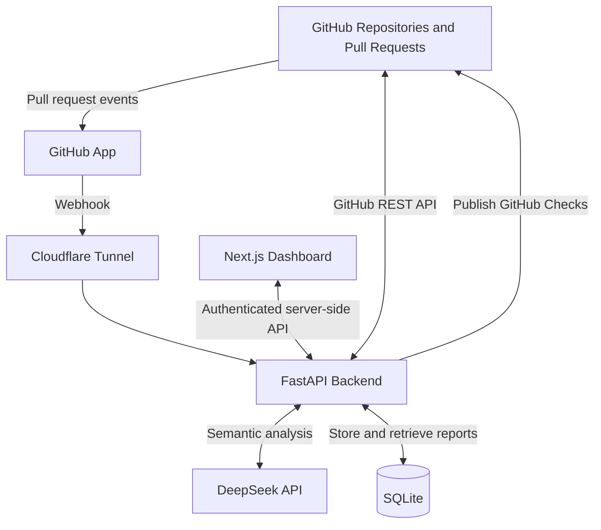

# RepoGuard AI

**AI-powered repository intelligence and pull request risk assessment.**

RepoGuard AI is a GitHub App that analyzes repository architecture, identifies potentially critical modules, and evaluates the impact of proposed code changes before merging. It combines DeepSeek-powered semantic analysis, sampled dependency mapping, and Python syntax verification to help maintainers make informed merge decisions.

## Features

- **Repository Analysis:** Scan authorized GitHub repositories and identify important files and architectural components.
- **Architecture Map:** Visualize sampled dependencies and potentially critical modules.
- **Pull Request Analysis:** Analyze changed code, potential regressions, and downstream impact.
- **Automatic Risk Alerts:** Trigger analysis when a pull request is opened, reopened, marked ready for review, or updated with new commits.
- **Risk Dashboard:** View risk levels, affected files, recommendations, and centered notification dialogs.
- **GitHub Checks:** Publish analysis results directly to pull requests.
- **Manual Analysis:** Scan repositories and open pull requests without configuring a webhook tunnel.

## Technology Stack

| Component | Technology |
| --- | --- |
| Frontend | Next.js, React, TypeScript |
| Backend | Python, FastAPI, Uvicorn |
| AI analysis | DeepSeek API |
| GitHub integration | GitHub App, REST API, Webhooks |
| Database | SQLite |
| Visualization | React Flow |
| Local webhook connectivity | Cloudflare Tunnel |
| Automated checks | GitHub Actions |

## System Architecture



The tunnel is only needed for inbound webhook delivery to a local backend. Manual scans use the GitHub REST API directly.

## Getting Started

### 1. Prerequisites

- Python 3.11+
- Node.js 20+
- Git
- A GitHub account and configured GitHub App
- A valid [DeepSeek API key](https://platform.deepseek.com/)
- `cloudflared` (optional; required for automatic webhook delivery to a local backend)

### 2. Clone the Repository

```bash
git clone https://github.com/Psy3che/RepoGuard-AI.git
cd RepoGuard-AI
```

### 3. Configure the GitHub App

1. Open [GitHub App settings](https://github.com/settings/apps).
2. Create a GitHub App or configure your existing app.
3. Enable the following repository permissions:

   | Permission | Access |
   | --- | --- |
   | Metadata | Read-only |
   | Contents | Read-only |
   | Pull requests | Read-only |
   | Checks | Read and write |

4. Subscribe to the **Pull request** webhook event for automatic analysis.
5. Generate and download a private key (`.pem`). Store it securely outside the Git repository.
6. Record the App ID and configure a webhook secret.
7. Install the app on the repositories you want to analyze.

### 4. Set Up the Backend

From the project root:

```bash
cd backend
python3 -m venv .venv
```

Activate the virtual environment:

**macOS / Linux**

```bash
source .venv/bin/activate
```

**Windows PowerShell**

```powershell
.\.venv\Scripts\Activate.ps1
```

Install the dependencies:

```bash
python -m pip install -r requirements.txt
```

Copy `.env.example` to `.env` in the `backend/` directory.

**macOS / Linux**

```bash
cp .env.example .env
```

**Windows PowerShell**

```powershell
Copy-Item .env.example .env
```

Edit `backend/.env` with your own credentials:

```dotenv
GITHUB_APP_ID=YOUR_GITHUB_APP_ID
GITHUB_PRIVATE_KEY_PATH=/absolute/path/to/github-app.pem
GITHUB_WEBHOOK_SECRET=YOUR_WEBHOOK_SECRET

DEEPSEEK_API_KEY=YOUR_DEEPSEEK_API_KEY
DEEPSEEK_MODEL=deepseek-flash

DASHBOARD_TOKEN=YOUR_SECURE_DASHBOARD_TOKEN
DATABASE_PATH=./repoguard.db
ALLOWED_ORIGINS=http://localhost:3000
MAX_PR_FILES=120
MAX_REPO_SOURCE_FILES=12
```

Use the actual GitHub App ID, an absolute path to its private key, and a strong random dashboard token. Keep the credentials on the backend only.

Start FastAPI:

```bash
python -m uvicorn backend.main:app --host 127.0.0.1 --port 8000
```

Verify that the backend is running:

```bash
curl http://127.0.0.1:8000/health
```

Expected response:

```json
{"status":"ok","app":"RepoGuard AI","version":"0.1.0"}
```

API documentation: [http://localhost:8000/docs](http://localhost:8000/docs).

### 5. Set Up the Frontend

Open a second terminal from the project root:

```bash
cd frontend
npm ci
```

Create `frontend/.env.local`:

```dotenv
REPOGUARD_API_BASE_URL=http://127.0.0.1:8000
REPOGUARD_DASHBOARD_TOKEN=YOUR_SECURE_DASHBOARD_TOKEN
```

> The frontend dashboard token must exactly match `DASHBOARD_TOKEN` in `backend/.env`. Do not use the `NEXT_PUBLIC_` prefix for secrets.

Start the development server:

```bash
npm run dev
```

Open **[http://localhost:3000](http://localhost:3000)**.

Keep both the frontend and backend running. The current authenticated live-data proxy is intended for local development.

### 6. Enable Automatic PR Analysis (Optional)

For automatic analysis of GitHub events, expose the running local backend through Cloudflare Tunnel in a third terminal:

```bash
cloudflared tunnel --url http://127.0.0.1:8000
```

Ensure that:

- The webhook is active, and the app subscribes to **Pull request** events.
- The GitHub webhook secret matches `GITHUB_WEBHOOK_SECRET`.
- The app is installed on the target repository.
- The tunnel and FastAPI backend remain running.

Creating or updating an open PR now triggers the backend analysis. The Dashboard displays the analysis progress and risk dialog when the corresponding repository is selected and the Dashboard is open. GitHub displays the result through Checks. A temporary tunnel URL may change when restarted; update the webhook URL accordingly.

## Usage and Demo

Use the prepared [RepoGuard-Demo](https://github.com/Psy3che/RepoGuard-Demo) repository, provided that the GitHub App is installed on it.

### Repository Analysis

1. Select an authorized repository in the Dashboard.
2. Click **Analyze Repository**.
3. View the architecture summary, important modules, and sampled dependency graph.

### Pull Request Risk Assessment

1. Open the **Pull requests** tab.
2. Select an open PR and click **Analyze PR** (or **Re-analyze PR**).
3. Inspect the risk dialog, AI findings, affected files, and merge recommendations.
4. Open the PR on GitHub to inspect its Check result.

With the webhook enabled, new or updated open PRs trigger analysis automatically. A push to a branch without an open PR does not trigger PR assessment in this version.

### Demo Cases

| Scenario | Example | Expected behavior |
| --- | --- | --- |
| Low-risk candidate | [Demo PR #2](https://github.com/Psy3che/RepoGuard-Demo/pull/2) | A documentation-only change; no executable logic modified. |
| High-risk candidate | [Demo PR #1](https://github.com/Psy3che/RepoGuard-Demo/pull/1) | A permission change allowing viewers to perform a deletion operation; flag potential authorization regression. |

Actual ratings depend on DeepSeek's response and the available evidence. The **Preview Low Risk** and **Preview High Risk** buttons display explicitly labeled illustrative examples, not live analysis results. Do not merge the intentionally unsafe demo PR.

### Risk Levels

| Risk | Meaning |
| --- | --- |
| `LOW` | No blocking findings identified within the reviewed scope. |
| `MEDIUM` | Potential impact; additional review recommended. |
| `HIGH` | Significant potential risk; human review required. |
| `CRITICAL` | Potentially severe impact; prioritize investigation before merging. |
| `UNKNOWN` | Insufficient evidence to determine risk. |

Verified Python syntax errors are distinguished from suspected AI findings. RepoGuard does not automatically merge or reject PRs.

## API Reference

All `/api/*` requests require a dashboard Bearer token. The Next.js server-side proxy supplies it for the local frontend.

| Method | Endpoint | Description |
| --- | --- | --- |
| GET | `/health` | Backend health check |
| GET | `/api/repositories` | List GitHub App-authorized repositories |
| POST | `/api/repositories/{owner}/{repo}/scan` | Start repository analysis |
| GET | `/api/repositories/{owner}/{repo}/scan` | Retrieve repository scan status |
| GET | `/api/repositories/{owner}/{repo}/pulls` | List open pull requests |
| POST | `/api/repositories/{owner}/{repo}/pulls/{number}/analyze` | Start PR risk assessment |
| GET | `/api/dashboard?repository=owner/repo` | Retrieve dashboard reports |
| POST | `/webhook` | Receive signed GitHub webhook events |

## Project Structure

```text
RepoGuard-AI/
├── backend/
│   ├── backend/
│   │   ├── main.py               # FastAPI routes and webhook handling
│   │   ├── config.py             # Environment configuration
│   │   ├── analyzer.py           # DeepSeek architecture and risk analysis
│   │   ├── github_api.py         # GitHub authentication and REST API
│   │   ├── service.py            # PR analysis orchestration
│   │   ├── storage.py            # SQLite persistence
│   │   ├── security.py           # Webhook validation and source filtering
│   │   ├── manual_scan.py        # On-demand repository scans
│   │   ├── pr_review.py          # On-demand PR reviews
│   │   ├── verification.py       # Read-only Python syntax verification
│   │   └── dashboard_adapter.py  # Dashboard response formatting
│   ├── tests/
│   ├── requirements.txt
│   └── .env.example
├── frontend/
│   ├── app/
│   ├── components/
│   ├── lib/
│   └── package.json
└── .github/
    └── workflows/
```

## Running Automated Tests

**Backend** (with the virtual environment activated):

```bash
cd backend
python -m pytest -q
```

**Frontend**:

```bash
cd frontend
npm run typecheck
npm run build
```

Run these commands from the project root in separate terminals. GitHub Actions also runs validation on pull requests.

## Security and Limitations
- Use the current single-operator Dashboard in a trusted local development environment only. It does not implement multi-user authorization.
- Obtain appropriate permission before sending private repository code or diffs to DeepSeek. Source filtering and redaction do not guarantee that all sensitive information is removed.
- Architecture and dependency analysis are sampled rather than exhaustive.
- AI assessments are advisory and cannot guarantee correctness, security, or absence of regressions.
- RepoGuard performs limited Python syntax verification without executing untrusted PR code; it does not run runtime or unit tests on analyzed repositories.
- Final merge decisions remain with repository maintainers.

## Project Links

- [Source code](https://github.com/Psy3che/RepoGuard-AI)
- [Demo repository](https://github.com/Psy3che/RepoGuard-Demo)
- [DeepSeek API documentation](https://api-docs.deepseek.com/)
